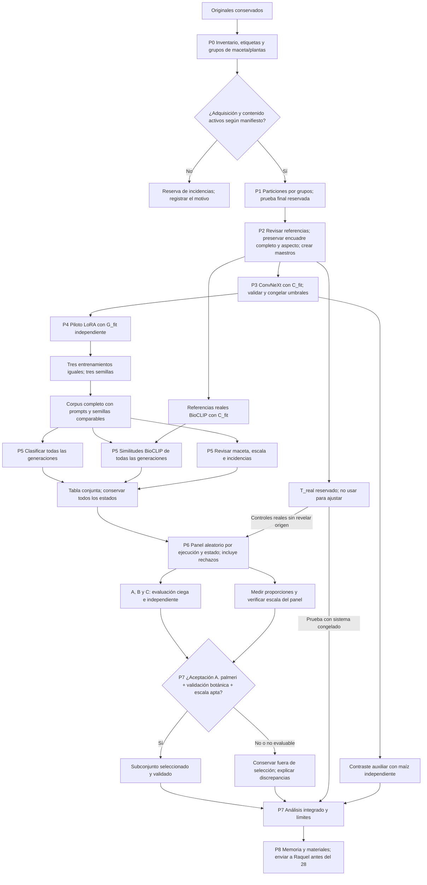

# Flujo único de imágenes del TFM

Integrado el 10 de noviembre de 2026. Este archivo representa el proceso definido en [PLANIFICACION_TFM.md](PLANIFICACION_TFM.md), que es la referencia principal. La geometría se desarrolla en [PROTOCOLO_ESCALA_MACETAS.md](PROTOCOLO_ESCALA_MACETAS.md). Sustituye las recomendaciones alternativas del flujo anterior; conserva al final la evidencia de la muestra, sin convertirla en un inventario completo.

## 1. Resultado que se persigue

Generar escenas de una maceta con una o varias plantas de A. palmeri, conservando y evaluando sus proporciones aparentes; auditar todas las salidas mediante ConvNeXt-Tiny, BioCLIP, escala y expertos; obtener un subconjunto seleccionado con trazabilidad. A. hybridus y A. retroflexus son las otras dos clases reales de comparación. El maíz se evalúa aparte como especie ajena al clasificador.

No hace falta conocer ahora los totales por especie para definir el proceso. Los recuentos, reservas y tamaño del panel se fijarán cuando el usuario aporte el inventario. No se presupone que existan suficientes grupos para todas las reservas.

## 2. Diagrama del proceso completo

Las flechas indican dependencias del proceso, no reutilización indiscriminada de imágenes. C_fit y G_fit no comparten grupos. T_real alimenta únicamente evaluación, no ajuste. El panel recibe los metadatos del muestreo, pero los expertos no ven scores, procedencia, ejecución ni decisiones automáticas. Las medidas geométricas se enlazan después por código.

El corpus íntegro U se archiva aunque una imagen no alcance D, por ejemplo por un fallo de lectura: se registra su estado de error. Si el panel es una muestra, las imágenes fuera de él siguen siendo auditadas computacionalmente y no se presentan como validadas por expertos.

## 3. Estados y decisión final

| Estado del filtro | Regla | Tratamiento |
| --- | --- | --- |
| Candidata A. palmeri | Solo supera el umbral de A. palmeri. | Elegible para selección si pasa expertos y escala. |
| Confusión | Solo supera el umbral de A. hybridus o A. retroflexus. | Auditar como posible fallo; no validar automáticamente como A. palmeri. |
| Ambigua | Supera varios umbrales. | Conservar y evaluar; fuera de selección automática. |
| Rechazada | No supera ningún umbral. | Conservar y muestrear también para detectar falsos rechazos. |
| No procesable | Fallo técnico identificado. | Registrar aparte, sin esconderlo del denominador pertinente. |

La validación botánica exige que al menos dos expertos coincidan individualmente tanto en A. palmeri como en aptitud morfológica. La selección final exige además candidatura automática y control de escala/escena superado según el protocolo fijado antes del panel. BioCLIP sirve para analizar similitud y discrepancias, sin añadir un umbral de selección no validado.

Un caso aprobado por expertos pero rechazado por el filtro se conserva como evidencia de falso rechazo. No se cambia el umbral después de verlo ni se borra ese caso. Las escenas no evaluadas por expertos son candidatas, no imágenes con validación experta.

## 4. Orden operativo y criterios de cierre

| Paso | Acción | Cierre verificable |
| --- | --- | --- |
| P0 | Inventariar y confirmar especie, maceta, individuos, sesiones y estadio. | Manifiesto con etiquetas, grupos y exclusiones justificadas. |
| P1 | Reservar C_fit, C_val, G_fit y T_real; mantener maíz aparte. | Sin solapamiento de grupos; reservas dimensionadas con inventario. |
| P2 | Revisar referencias; conservar rectángulo completo, EXIF, color y aspecto exacto. | M029: maestros con lado máximo 2048 y config congelada; sin cm/píxel común. Validación métrica aparte. |
| P3 | Entrenar ConvNeXt, validar configuración y umbrales. | Modelo y regla de cuatro estados congelados. |
| P4 | Pilotar LoRA y ejecutar tres entrenamientos sobre G_fit. | Tres adaptadores, mismas condiciones y semillas distintas. |
| P5 | Generar, conservar y auditar todas las salidas. | Tabla por imagen con scores, similitudes y estado geométrico. |
| P6 | Muestrear todas las categorías y evaluar con A/B/C y medidas de escala. | Mismo panel, rúbrica fijada y respuestas independientes completas. |
| P7 | Seleccionar, comparar instrumentos y evaluar maíz/prueba real por separado. | Subconjunto validado, fallos y denominadores explícitos. |
| P8 | Integrar resultados reales y reproducibilidad en la memoria. | PDF revisado y envío a Raquel antes del 28 de noviembre. |

Reglas vigentes M029: conservar el encuadre adquirido y las proporciones aparentes, sin zoom por planta, igualación de macetas, reconstrucción de tejido ni reencuadre sintético para esconder errores. Sin cm/píxel común. Una referencia no fiable impide evaluación métrica, no crea por sí sola una exclusión del maestro general. El lector de cada modelo debe respetar el rectángulo completo. Véase la [comparación](doc/REVISION_PREPROCESADO_2026-11-12.md).

## 5. Evidencia conservada del análisis de muestra

Se revisaron visualmente las 13 imágenes en una hoja de contacto y se ampliaron cuatro casos representativos: `DSC_0062`, `DSC_0102`, `DSC_0714` y `maiz`. Se leyeron dimensiones, modo y metadatos EXIF de los 13 archivos.

| Hallazgo observado | Consecuencia |
| --- | --- |
| 13 JPEG RGB: 9 de 3008 × 2000 píxeles y 4 de 3872 × 2592 | Hay margen para recortar y reducir resolución; no se necesita superresolución como paso inicial. |
| EXIF de Nikon D70 y D3000, con fechas de 2025 y 2026 | Registrar cámara y sesión; comprobar su asociación con la especie y el estadio. Las fechas EXIF deben contrastarse con el registro de captura. |
| Orientación EXIF 6 en `DSC_0102`, `DSC_0130` y `DSC_0275` | Aplicar la orientación antes de calcular coordenadas de recorte. |
| Tarjetas amarillas en `DSC_0062` y `DSC_0077` | El usuario las colocó como referencia dimensional; medirlas si se conocen sus dimensiones y registrar su presencia. No eliminarlas mediante IA ni variar la escala del encuadre para excluirlas. |
| Macetas, sustrato, malla con líneas, tubos y sombras marcadas | Posibles pistas ajenas a la morfología. Hay que comprobar si varían sistemáticamente entre clases. |
| Plantas pequeñas y otras con mayor desarrollo y solapamiento foliar | Controlar estadio, ocupación del encuadre y visibilidad; no seleccionar solo plantas grandes y fáciles. |
| En `maiz.JPG` hay hojas que llegan al borde superior y parecen quedar truncadas | Registrar la visibilidad incompleta; no inventar el contenido ausente. |
| No hay hashes SHA-256 repetidos | No hay archivos idénticos en esta muestra; esto no descarta fotos próximas ni imágenes del mismo individuo. |

Los nombres de los doce archivos `DSC_...` no proporcionan una correspondencia fiable con las tres especies. Este análisis no les asigna una identidad botánica ni permite evaluar el balance entre clases. Tampoco confirma cuántos individuos distintos contienen.

Las observaciones están registradas en `analisis_muestra/metadata.json` y `analisis_muestra/contact_sheet.jpg`. La hoja de contacto aplica la orientación EXIF; las dimensiones rotuladas corresponden a las almacenadas en el archivo.

